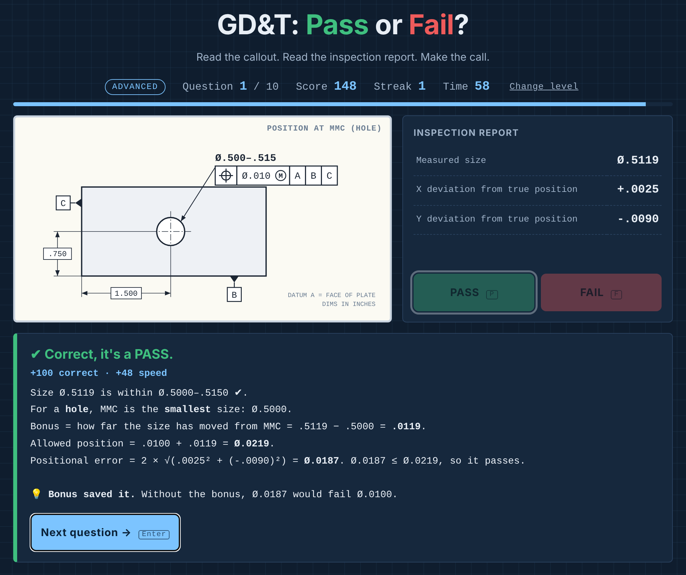

# GD&T: Pass or Fail?

**[▶ Play it in your browser](https://slee9817.github.io/gdt-pass-or-fail/)**

A quick-fire quiz for reading engineering drawings. Each question shows a drawing callout
and an inspection report. You decide whether the part passes, against the clock. After each
answer you see the worked math, so a miss teaches you something.

Every question is generated at random, so no two rounds are the same, and many are built
around the mistakes people really make at the inspection bench.

## Two levels

**Beginner: reading the print**
- Linear and diameter tolerances (±)
- Limit dimensions (both limits stacked)
- Unilateral tolerances (`+.002 / −.000`): the trap is a part just under the zero side
- Radii
- Angles, including `±0°30'` (30 minutes is 0.50°, not 0.30°)
- Title block tolerances: `1.75` gets ±.01, but `1.750` only gets ±.005

**Advanced: geometric tolerancing**
- Flatness
- Position with no modifier, where the trap is that X and Y each look fine but the
  diameter zone is a circle, not a square
- Position at MMC and LMC, with bonus tolerance (and size checked first)
- Perpendicularity at MMC, including `Ø.000 Ⓜ`
- Profile of a surface, where the trap is a total spread under the tolerance but one
  side outside ±half
- Circular runout, where the trap is that neither indicator reading is over on its own
  but the full swing is

## Scoring

100 points for a correct answer, up to 50 more for speed, and 10 per question in your
current streak. Running out of time counts as wrong. Each round is 10 questions that ramp
from easier to harder types, and ends with a letter grade and a review of every miss.
The best score for each level is saved in your browser.

## How it works

| File | What it does |
|---|---|
| `questions.js` | One generator per question type. Each returns the drawing, the report rows, the correct answer, and the worked explanation |
| `game.js` | Draws the callouts in SVG (feature control frames, datums, dimensions), and runs the timer, scoring, and review |
| `verify.js` | The answer checker: re-solves thousands of questions of every type from what's on screen (`node verify.js`) |
| `index.html`, `style.css` | The page |

All the math is done in whole ten-thousandths of an inch (`.5050"` is stored as `5050`), so
floating-point rounding can never flip an answer. Generators also keep measured values
at least a couple of ten-thousandths away from the limit, so no question is too close to call.

To check the answers, `verify.js` is a separate solver that re-solves each question using only
what the player sees: the text on the drawing and in the report. Over 75,000 generated
questions it agreed every time. That check also caught a real bug: a .3125" hole printed
as ".313", so the drawing and the answer disagreed. The solver also confirms each question
type comes out close to 50/50 pass and fail, so guessing doesn't pay.

Plain HTML, CSS, and JavaScript: no frameworks, no build step, no server.

## Running it locally

Open `index.html` in any browser.

## Note

This is a practice tool built around common inspection scenarios. It's not a substitute
for ASME Y14.5 or your company's inspection procedures.
